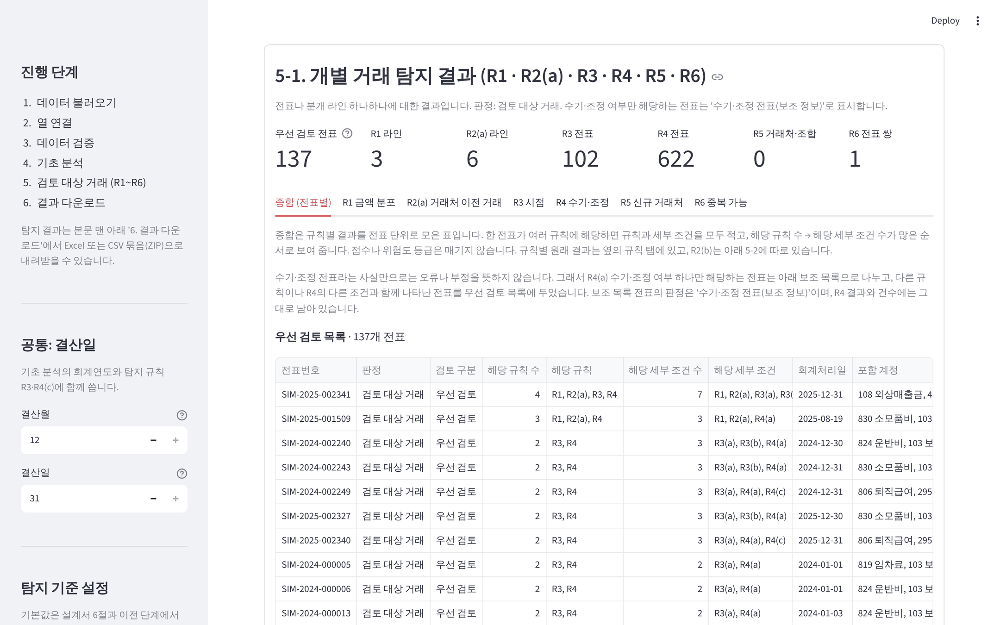

# AuditLens

분개장(Journal Entry) 데이터를 분석해 감사인이 추가로 검토할 필요가 있는 비경상적 거래와 이상 징후를 찾아 주는 Python + Streamlit 프로그램입니다.

> AuditLens의 탐지 결과는 **검토 후보**일 뿐이며, 부정이나 오류를 확정하지 않습니다. 감사인의 판단을 대체하지 않습니다.



## 문서

| 문서 | 내용 |
| --- | --- |
| [프로젝트 소개서](docs/프로젝트_소개서.md) | 해결하려는 문제, 주요 기능, 설계 원칙, 개발 과정, 한계 |
| [탐지 규칙과 분석 로직](docs/탐지규칙_및_분석로직.md) | 처리 흐름, 검증 V1~V12, 규칙 R1~R6의 계산·기본값·한계, 종합 방식 |
| [검증 결과 보고서](docs/검증결과_보고서.md) | 자동 테스트, 제조업·IT 서비스업 가상 데이터 대조, 화면 검증, 미확인 항목 |
| [시연 시나리오](docs/시연_시나리오.md) | 실행 화면과 7분 시연 순서 |
| [설계서](docs/설계서.md) | 1·2단계 요구사항과 설계 당시 기록 |

## 현재 진행 단계

| 단계 | 내용 | 상태 |
| --- | --- | --- |
| 1 | 요구사항 구체화, 개발 범위 확정 | 완료 |
| 2 | 화면·데이터 구조·탐지 로직·기술 구성 설계 | 완료 |
| 3 | MVP 구현 | 완료 (가상 분개장 생성기, 업로드·검증, 기초 분석, 탐지 규칙 R1~R6, 탐지 기준 설정, 결과 다운로드, 금액 한 열 형식, 다른 업종·회계연도 대응) |
| 4 | 가상 테스트 데이터로 기능 검증 | 완료 (IT 서비스업 가상 데이터 검증: `validation/it_service/`. 대용량 처리 시간은 측정만 했으며 아래 '알려진 한계'에 적음) |
| 5 | 오류 수정, 사용성 개선 | 완료 (2026-11-05) |
| 6 | 포트폴리오 문서, 테스트 결과, 시연 자료 | 진행 중 (위 '문서' 표의 소개서, 로직 설명, 검증 보고서, 시연 시나리오) |

## 확정된 범위

- 기술: Python 3.11, Streamlit(1.49 이상, 차트는 Streamlit 기본 차트), pandas, openpyxl, pytest
- 탐지 규칙(MVP): R1 계정별 금액 분포 이탈, R2 과거 패턴 대비 이례적 금액·빈도, R3 기말·결산 전후 및 비정상 시점 분개, R4 수기·조정 분개, R5 신규 거래처, R6 중복 가능 분개
- 샘플 데이터: 가상의 제조업 회사, 전기·당기 2년치 분개장 (앱 안에서 생성)
- 검증 데이터: 가상의 IT 서비스업 회사 분개장과 정답표 (`validation/it_service/`)
- 화면 언어: 한국어

설계 당시 기록은 [docs/설계서.md](docs/설계서.md)에 있습니다. 설계서와 실제 동작이 다른 부분(R2(a) 비교 묶음, R3 월말 옵션, 차트 등)은 [탐지 규칙과 분석 로직](docs/탐지규칙_및_분석로직.md) 7절에 정리했습니다.

## 실행 방법

Python 3.11 이상이 필요합니다. 터미널(명령 프롬프트)에서 저장소 폴더로 이동한 뒤 아래 명령을 차례로 실행합니다.

```bash
pip install -r requirements.txt   # 필요한 라이브러리 설치 (처음 한 번)
streamlit run app.py              # 프로그램 실행 → 브라우저에서 http://localhost:8501 이 열림
```

화면에서 "가상 샘플 데이터로 체험"을 고르면 가상 분개장으로 바로 확인할 수 있습니다.
"내 파일 업로드"에서는 분개장 파일을 올려 검증 결과를 볼 수 있고, 오류 예시 파일도 내려받을 수 있습니다. 받는 파일 형식은 아래 '지원하는 파일 형식'에 있습니다.
검증을 통과하면 "4. 기초 분석"에서 전표 현황, 계정별 분석(상위 계정, 전체 계정), 월별 추이, 회계연도별 요약과 전기·당기 같은 달 비교(결산월 기준 회계연도)를 볼 수 있습니다.
기초 분석은 검증을 통과한 행만 사용하며, 이상 거래 탐지 결과가 아닙니다.

"5. 검토 대상 거래 (R1~R6)"에서는 계정별 금액 분포 이탈(R1), 과거 패턴 대비 이례적 금액·빈도(R2), 기말·결산 전후 및 비정상 시점 분개(R3), 수기·조정 분개와 특정 조건(R4), 신규 거래처·신규 계정 조합(R5), 중복 가능 분개(R6)에 해당하는 거래를 탐지 이유·판단 근거·규칙의 한계와 함께 보여 줍니다. 결과는 오류나 부정의 결론이 아니라 '검토 대상 거래'입니다. R5는 기준금액을 입력해야 검사합니다. 종합(전표별) 화면은 수기·조정 여부(R4(a))만 해당하는 전표를 보조 목록으로 나누고, 나머지를 해당 규칙 수 → 해당 세부 조건 수 순서로 보여 줍니다(점수나 가중치는 쓰지 않음). 탐지 기준은 왼쪽 사이드바 '탐지 기준 설정'에서 규칙별로 켜고 끄거나 임계값을 바꿀 수 있고, '기본값으로 되돌리기' 버튼으로 한 번에 기본값으로 돌아갑니다. 기본값과 현재 적용값의 비교는 5-3에 있습니다. 규칙의 계산 방법과 한계는 [탐지 규칙과 분석 로직](docs/탐지규칙_및_분석로직.md), 코드는 `auditlens/detection.py`에 있습니다.

"6. 결과 다운로드"에서는 화면과 같은 탐지 결과를 Excel 파일(15개 시트) 또는 CSV 묶음(ZIP)으로 내려받을 수 있습니다. 첫 장 '안내'에 판정의 뜻과 한계, 적용한 기준을 함께 적습니다.

## 지원하는 파일 형식

| 파일 | 처리 |
| --- | --- |
| CSV (.csv) | 쉼표(,)로 열을 나눈 파일을 읽습니다. 글자 인코딩은 UTF-8(BOM 있어도 됨) 또는 CP949(한글 Windows Excel의 'CSV' 저장)입니다. |
| Excel (.xlsx, .xlsm) | 시트가 여러 개이면 화면에서 분개장 시트를 고릅니다. |
| 구형 Excel (.xls) | 읽지 않습니다. .xlsx로 다시 저장하라는 안내를 보여 줍니다. |

- 파일의 첫 행이 열 이름이어야 합니다. 머리글 행을 자동으로 찾지 않습니다. 필수 항목에 맞는 열 이름을 하나도 찾지 못했고 이름 없는 열('Unnamed: …')이 있으면, 첫 행이 제목 행일 수 있다는 안내를 보여 줍니다.
- 금액은 차변·대변 두 열 형식과 금액 한 열 + 차대 구분 열 형식을 모두 받습니다. 차대 구분 값(예: 차/대, D/C)이 차변인지 대변인지는 화면에서 사용자가 고릅니다.
- CSV가 열 하나로만 읽히고 그 열 이름에 세미콜론(;)이나 탭이 있으면, 구분 기호가 쉼표가 아니라는 안내를 보여 주고 읽지 않습니다. 구분 기호를 추측해서 다시 읽지는 않습니다.
- CSV 데이터 행의 칸 수가 머리글(1행)보다 많으면(예: 행 끝 쉼표 `J1,101,`) 이렇게 처리합니다. 따옴표 안의 쉼표는 칸으로 세지 않습니다.
  - 추가된 칸이 모두 빈 값(공백만 있는 칸 포함)이면 그 칸만 제거하고 머리글의 열까지 읽습니다. 화면에 제거 전후 열 개수(예: 열 7개 → 6개), 빈 열이 붙어 있던 행 수, 제거한 칸이 모두 빈 값이었다는 사실을 안내합니다.
  - 추가된 칸에 값이 하나라도 있으면 어느 값이 어느 열의 값인지 알 수 없으므로 제거하지 않습니다. 열 구조가 맞지 않는다는 오류와 해당 행 번호 예시, 수정 방법(머리글에 빠진 열 이름 추가, 행의 열 개수 맞추기, 쉼표가 든 값은 큰따옴표로 감싸기)을 보여 주고 읽기를 멈춥니다.
- CSV 데이터 행의 칸 수가 머리글보다 적으면 빠진 칸을 빈 값으로 읽습니다. 필수 값이 비는 등의 문제는 3단계 데이터 검증에서 경고로 알립니다.
- 머리글 행이 없는 빈 CSV, UTF-8과 CP949 어느 쪽으로도 읽을 수 없는 CSV, 열 수 없는 Excel(손상·암호)은 원인을 안내하고 읽지 않습니다.
- 앞뒤 공백을 빼면 이름이 같은 열이 있으면 뒤의 열 이름에 '.1'을 붙여 구분하고 화면에 알립니다(값은 바꾸지 않음).

## 테스트 방법

```bash
python -m pytest -q
```

GitHub에 PR을 올리거나 main이 바뀔 때마다 GitHub Actions가 같은 테스트를 자동으로 실행합니다(2026-11-05 기준 384개 통과).

## 검증 현황

아래 숫자는 이 저장소의 **가상 검증 데이터 두 가지에서 나온 결과**입니다. 탐지율·오탐률 같은 일반적인 탐지 성능 수치가 아니며, 다른 회사 자료에서 같은 비율이 나온다는 뜻도 아닙니다.

- **제조업 가상 샘플**(앱 안의 '가상 샘플 데이터', 9,326행): 기본값에서 우선 검토 137개, 보조 목록 570개 전표가 나옵니다. 일부러 넣은 패턴은 화면의 '테스트 정답표'에서 볼 수 있습니다.
- **IT 서비스업 가상 데이터**(`validation/it_service/`, 2,708행): CSV, Excel, 금액 한 열 형식 세 파일로 검증했습니다. 기본값에 검증용으로 R5 기준금액 20,000,000원만 넣었을 때 우선 검토 22개, 보조 목록 95개 전표가 나옵니다.
  - 정답표(`ground_truth/가상IT_정답표.csv`)는 **30개 사례, 49행**입니다. 한 사례가 라인·전표·기간별로 여러 행이 될 수 있어 행이 더 많습니다.
  - 사례 구분: 탐지 대상 15개(19행), 탐지되지 않아야 할 정상 거래 11개(24행), 정상이지만 규칙 한계로 탐지되는 오탐 확인 3개(5행), 여러 규칙 동시 해당 1개(1행)
  - 49행 모두 예상대로 나왔고, Streamlit 화면과 내려받은 Excel·ZIP도 같은 결과입니다. 절차와 예상 결과는 `validation/it_service/검증절차_및_예상결과.md`에 있습니다.
- 정답표와 일치한다는 것은 프로그램이 정한 기준대로 계산한다는 뜻입니다. 실제 감사에서의 탐지 효과를 입증하지는 않습니다.
- 규칙별 건수, 정답표 대조 표, 확인하지 않은 항목은 [검증 결과 보고서](docs/검증결과_보고서.md)에 있습니다.

## 알려진 한계

- 받는 파일 형식에 제한이 있습니다(위 '지원하는 파일 형식'). 제목 행이 있는 파일, 쉼표가 아닌 구분 기호의 CSV, 머리글보다 많은 칸에 값이 들어 있는 CSV, .xls는 파일을 고쳐 다시 올려야 합니다.
- 대용량 자료의 처리 시간은 충분히 확인하지 않았습니다. 가상 자료를 이어 붙인 약 4만 6천 행에서 탐지에 1분 가까이 걸렸습니다.
- 다운로드 파일을 Microsoft Excel 프로그램에서 직접 열어 보는 확인은 하지 않았습니다(Python으로 내용만 확인).
- 감사기준서 문단 번호와 문구는 원문으로 확인하지 않아 문서와 화면에 인용하지 않습니다. 모든 수치 기준은 조정 가능한 기본값입니다.

## 데이터 원칙

이 저장소에는 가상으로 생성한 테스트 데이터만 포함합니다. 실제 회사의 자료는 올리지 않습니다.
