# AuditLens 시연 시나리오

> 화면 사진은 2026-11-06 main `3cf55d6`을 Streamlit 1.66.1로 실행해 자동 브라우저(Playwright, Chromium)로 찍었습니다. 모든 데이터는 가상 데이터입니다.

## 준비

```bash
pip install -r requirements.txt
streamlit run app.py      # 브라우저에서 http://localhost:8501
```

- 시연 시간: 약 7분(기본 흐름 5분 + 다른 회사 파일 2분)
- 2부에서 쓸 파일: `validation/it_service/upload/가상IT_분개장_2024_2025.csv`
- 첫 화면을 열면 가상 샘플 데이터 분석이 바로 시작됩니다(9,326행 기준 수 초).

## 1부. 가상 제조업 샘플로 전체 흐름 (약 5분)

### 1. 첫 화면과 데이터 불러오기

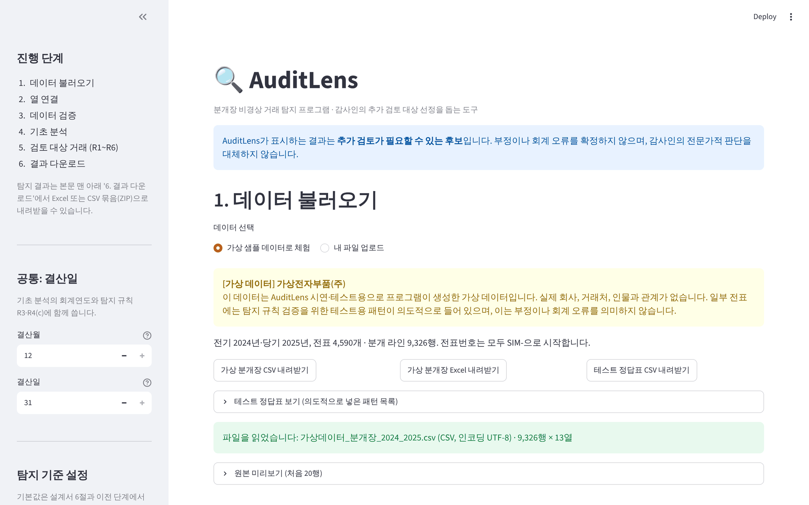

- **할 일**: '가상 샘플 데이터로 체험'이 선택된 상태를 보여 줍니다.
- **말할 것**: "분개장에서 감사인이 먼저 볼 거래를 골라 주는 도구입니다. 맨 위 안내처럼 결과는 검토 후보이고 부정이나 오류의 결론이 아닙니다. 지금은 프로그램이 만든 가상 제조업 회사의 2년치 분개장 9,326행입니다."
- 선택: '테스트 정답표 보기'를 열어 일부러 넣은 패턴 목록을 보여 줍니다.

### 2. 열 연결

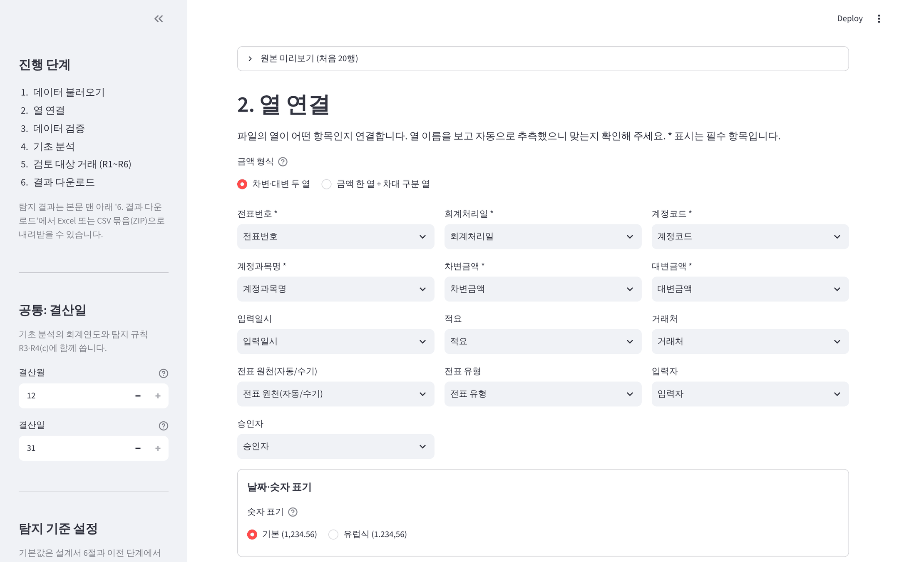

- **말할 것**: "회사마다 열 이름이 달라서, 열 이름을 보고 전표번호·회계처리일 같은 표준 항목에 자동으로 짝지어 보여 주고 사용자가 확인합니다. 금액이 한 열에 있고 차대 구분 열이 따로 있는 형식도 받습니다."

### 3. 데이터 검증

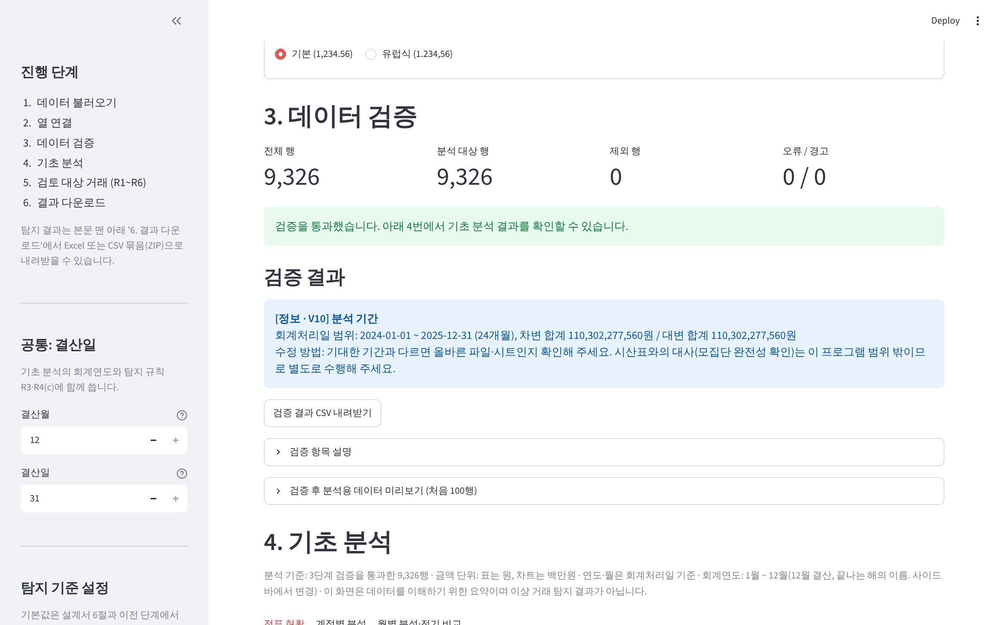

- **말할 것**: "분석 전에 필수 열, 날짜·금액 형식, 전표별 차대 균형, 중복 행 등 12개 항목을 검사합니다. 이 샘플은 오류·경고가 없습니다. 문제가 있으면 행 번호와 고치는 방법을 알려 주고, 값을 임의로 고치지 않습니다."
- 선택: '내 파일 업로드'의 오류 예시 파일로 경고 화면을 보여 줄 수 있습니다.

### 4. 기초 분석

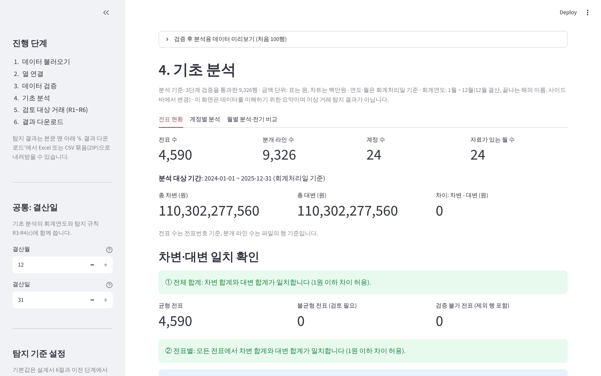
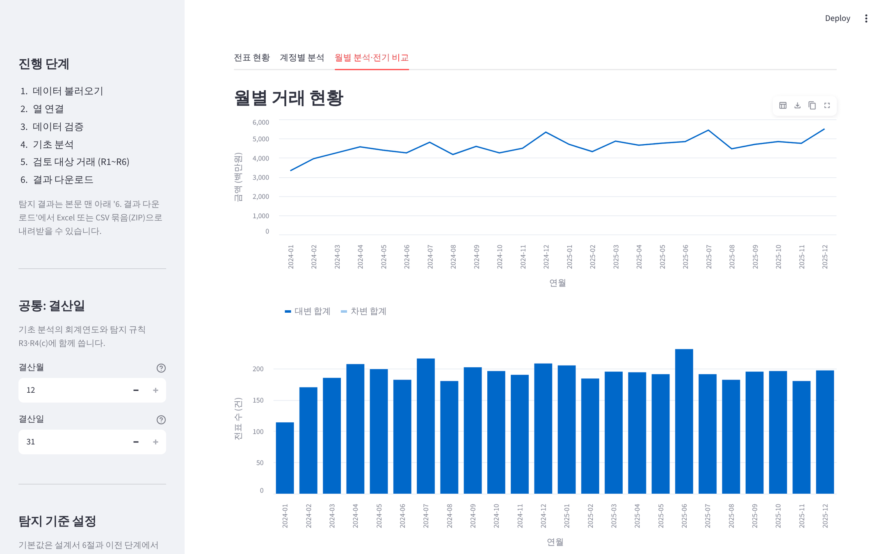

- **말할 것**: "탐지 전에 자료를 이해하는 단계입니다. 전표 수, 차변·대변 합계, 상위 계정, 월별 추이, 전기·당기 같은 달 비교를 봅니다. 이것은 탐지 결과가 아닙니다."

### 5. 검토 대상 거래

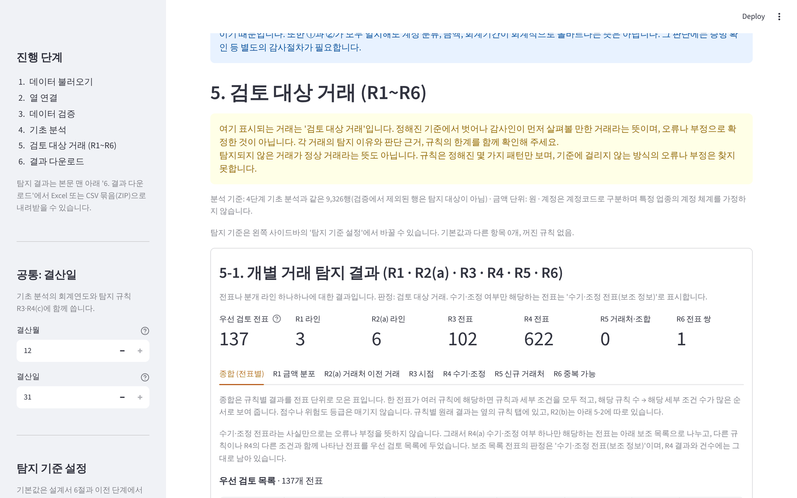
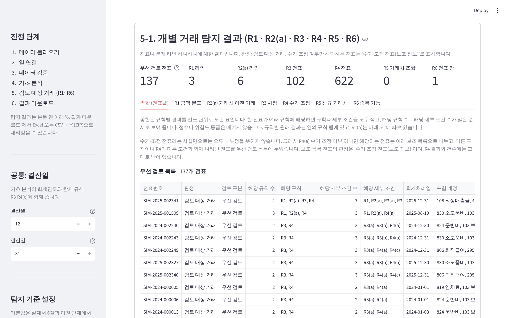

- **말할 것**: "규칙 R1~R6의 결과를 전표별로 모았습니다. 우선 검토 137개, 그리고 수기·조정 전표라는 사실만 해당하는 570개는 보조 목록으로 나눴습니다. 수기 전표 자체를 위험으로 보지 않기 때문입니다. 점수 없이 해당 규칙 수, 세부 조건 수 순서로 정렬합니다."
- 첫 행 `SIM-2025-002341`을 가리킵니다: "결산일에 회계처리하고 다음 해 1월에 입력한 2억 8천만 원 수기 매출 조정입니다. 금액 분포, 거래처 이력, 시점, 수기 조건 네 규칙에 모두 해당합니다."

### 6. 규칙별 근거

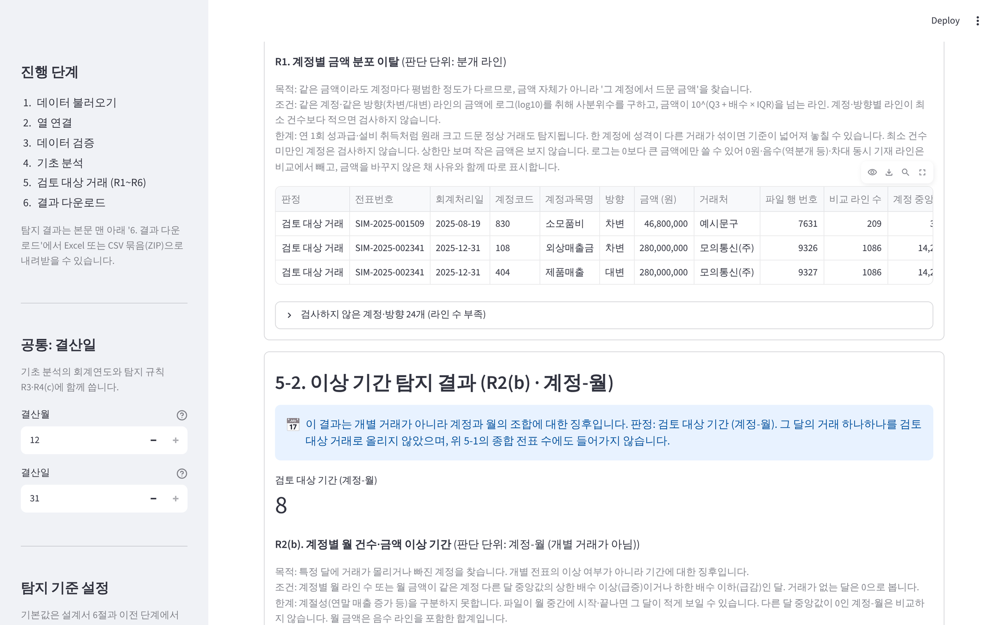

- **말할 것**: "각 규칙 탭에는 목적, 조건, 한계가 먼저 나오고, 결과마다 비교한 라인 수, 계정 중앙값, 상한 금액이 함께 나옵니다. 소모품비 4,680만 원은 이 계정 평소 금액이 수십만 원대라 탐지되었습니다."

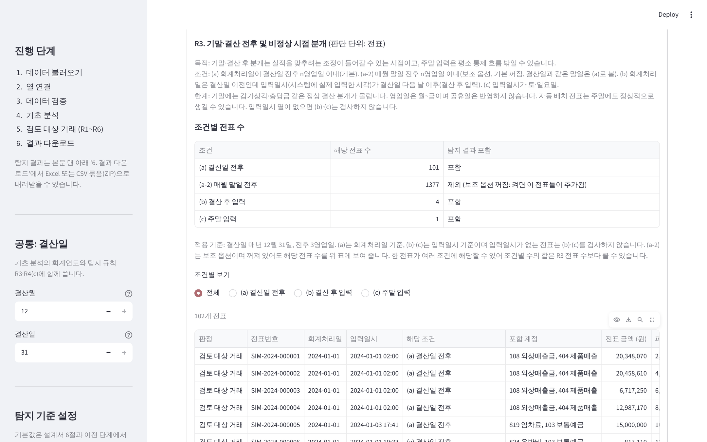

- **말할 것**: "R3는 조건별 전표 수를 보여 줍니다. 매월 말일 조건은 기본으로 꺼 두었고, 켜면 몇 개가 추가되는지도 함께 보여 줍니다. 기말에 정상 결산 분개가 몰린다는 한계도 적혀 있습니다."

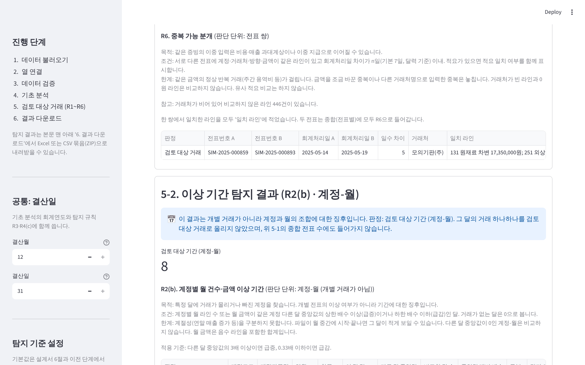

- **말할 것**: "같은 계정·거래처·금액이 7일 안에 두 번 입력된 전표 쌍입니다. 매달 같은 금액의 임차료는 간격이 7일보다 길어 걸리지 않았습니다."

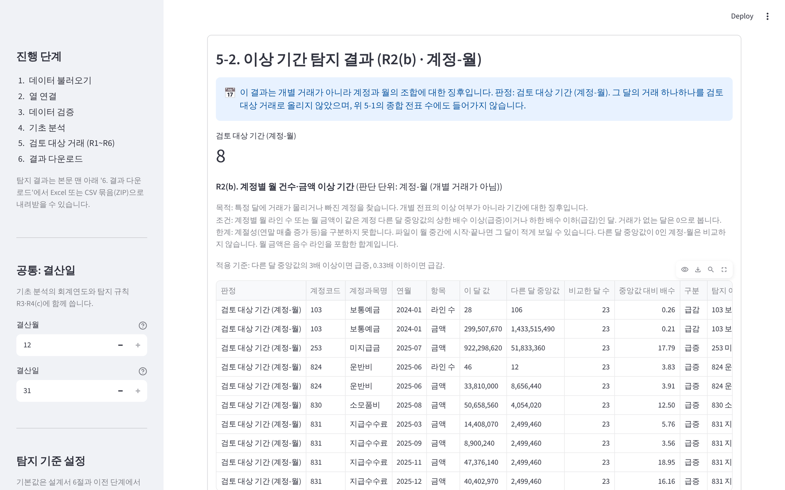

- **말할 것**: "R2(b)는 개별 거래가 아니라 '계정-월'에 대한 판단이라 따로 보여 줍니다. 2025년 6월 운반비 건수가 평소의 약 4배입니다. '그 달의 거래 보기'로 해당 전표를 찾아갈 수 있습니다."

### 7. 탐지 기준 설정

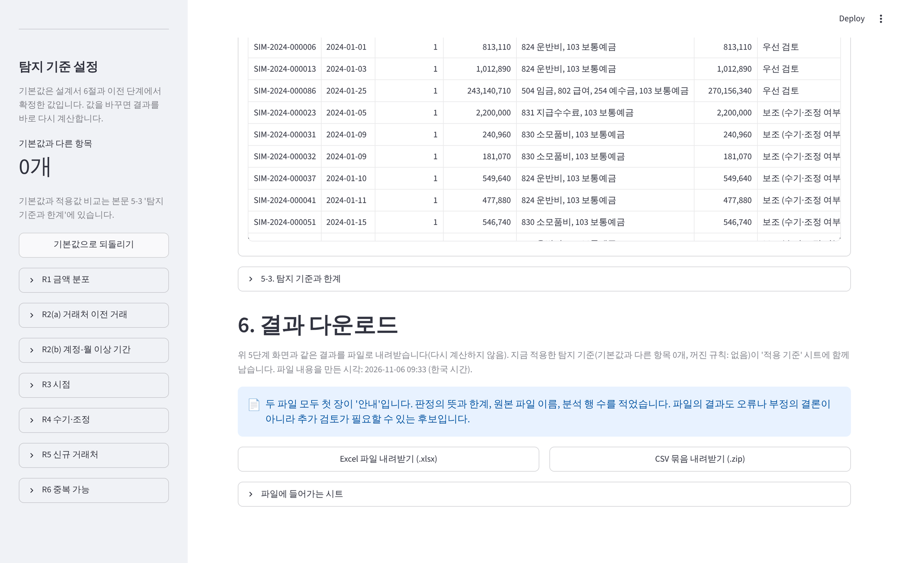

- **할 일**: 사이드바에서 R1 배수를 바꾸거나 규칙 하나를 꺼서 결과가 바로 바뀌는 것을 보여 준 뒤 '기본값으로 되돌리기'를 누릅니다.
- **말할 것**: "기준값은 감사기준서가 정한 숫자가 아니라 조정 가능한 기본값입니다. 바꾼 내용은 화면과 결과 파일에 남습니다."

### 8. 결과 다운로드

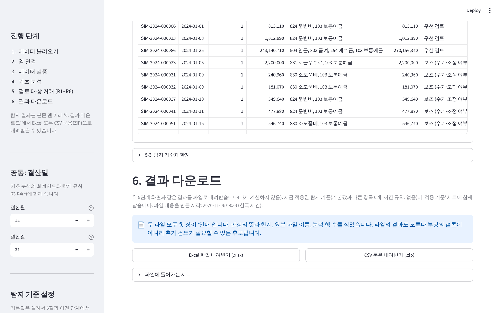

- **말할 것**: "화면과 같은 결과를 Excel 15개 시트나 CSV 묶음으로 내려받습니다. 첫 장에 판정의 뜻과 한계, 적용 기준이 들어가 조서에 붙일 수 있습니다."

## 2부. 다른 업종 회사 파일 (약 2분)

### 9. IT 서비스업 파일 올리기

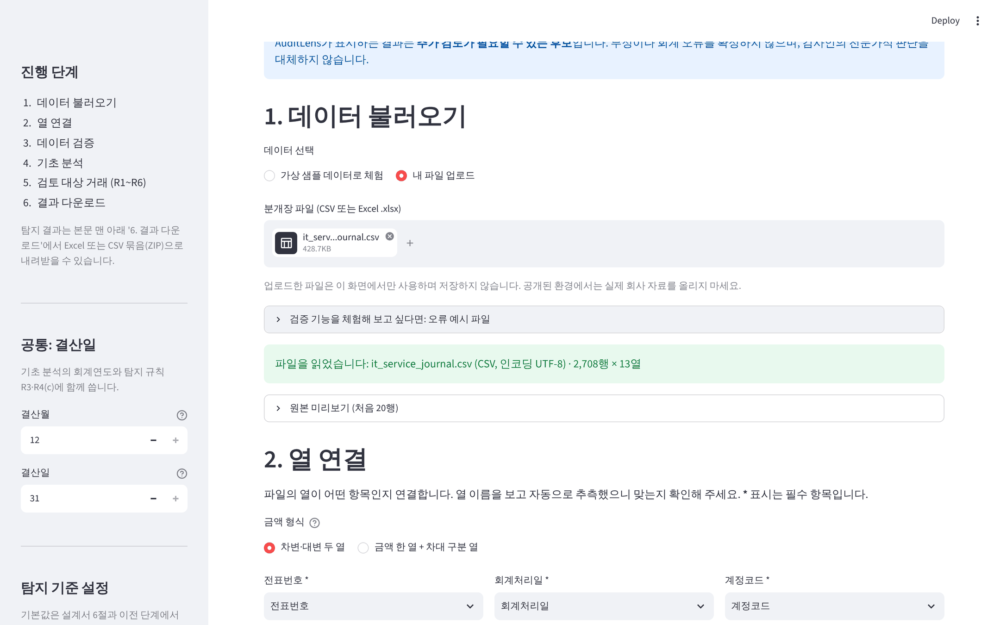

- **할 일**: '내 파일 업로드'를 고르고 `가상IT_분개장_2024_2025.csv`를 올립니다. (화면 사진은 자동화 도구 한계로 파일 이름을 영문으로 바꿔 올렸습니다.)
- **말할 것**: "계정 체계가 다른 가상 IT 서비스 회사 자료입니다. 13개 열이 자동으로 연결되고 검증을 통과합니다."

### 10. R5 기준금액을 넣고 결과 보기

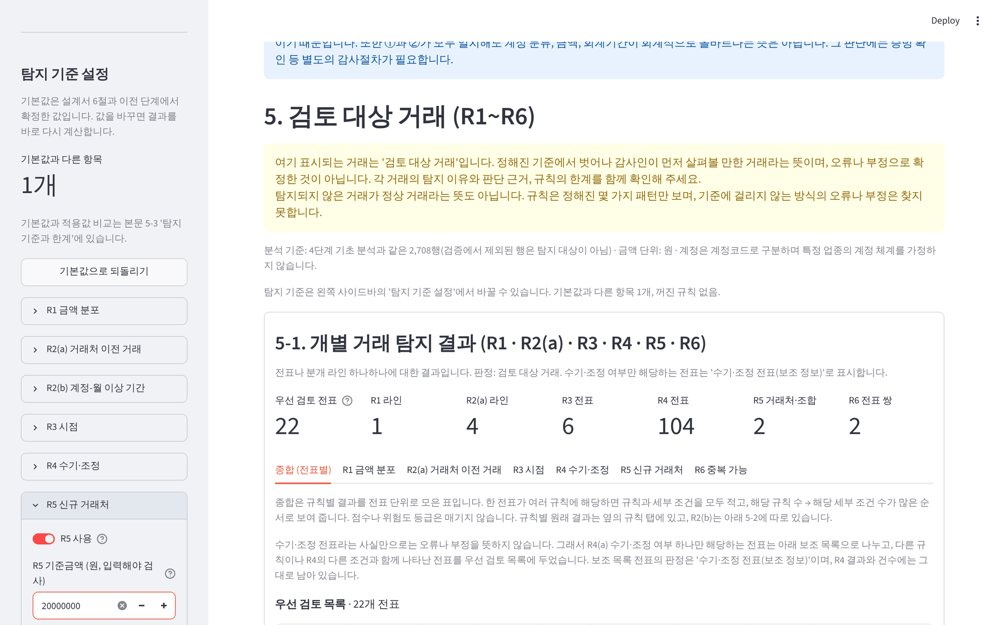

- **할 일**: 사이드바 'R5 신규 거래처'를 열고 기준금액에 `20000000`을 입력합니다.
- **말할 것**: "신규 거래처 규칙은 중요성 판단이 필요해서 기본값이 없고, 감사인이 금액을 넣어야 검사합니다. 이 데이터는 30개 사례의 정답표를 따로 만들어 두었고, 우선 검토 22개, 보조 95개가 정답표와 같게 나옵니다."

## 마무리 멘트

"결과는 정한 기준대로 계산된 검토 후보입니다. 가상 데이터 두 가지로 정답표와 화면·다운로드를 대조했지만, 실제 회사 자료에서의 탐지 효과를 보여 주지는 않습니다. 확인하지 않은 항목은 검증 결과 보고서에 따로 적어 두었습니다."

## 시연 중 주의

- 실제 회사 자료를 올리지 않습니다. 공개 환경에서는 특히 그렇습니다.
- 질문에 '이 거래는 부정입니다'처럼 답하지 않습니다. '검토가 필요할 수 있는 거래'로 말합니다.
- 큰 파일은 탐지에 시간이 걸릴 수 있습니다(가상 46,630행 약 57초).
