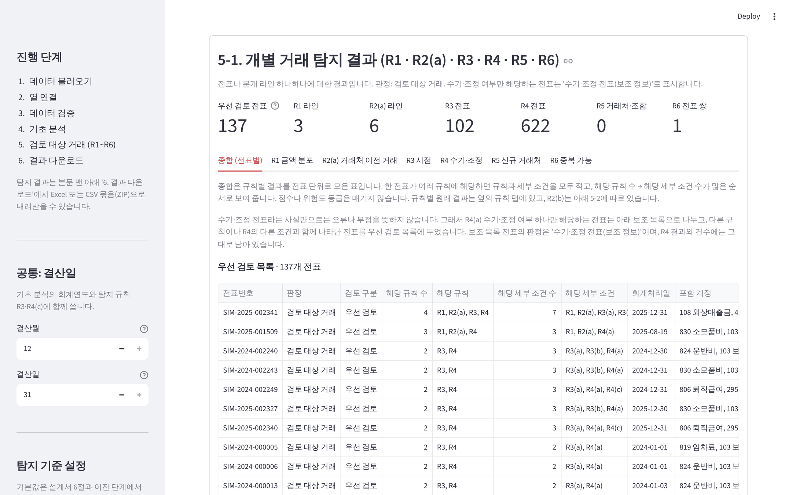

# AuditLens 프로젝트 소개서

**분개장 데이터에서 감사인이 먼저 살펴볼 거래를 골라 주는 Python + Streamlit 프로그램**

## 1. 한눈에 보기

| 항목 | 내용 |
| --- | --- |
| 목적 | 분개장(Journal Entry) 전체를 일정한 기준으로 훑어, 추가 검토가 필요할 수 있는 거래를 이유와 근거와 함께 보여 줍니다. |
| 사용자 | 분개 테스트를 수행하는 감사인, 내부감사·회계 담당자 |
| 입력 | 분개장 CSV 또는 Excel 파일(차변·대변 두 열 형식 또는 금액 한 열 + 차대 구분 형식) |
| 출력 | 화면의 검토 대상 거래 목록과 판단 근거, Excel(15개 시트)·CSV 묶음(ZIP) 결과 파일 |
| 기술 | Python 3.11, Streamlit, pandas, openpyxl, pytest, GitHub Actions |
| 규모 | 화면 924줄, 분석 모듈 8개 약 3,200줄, 자동 테스트 384개 |
| 데이터 | 가상 데이터만 사용(제조업 샘플, IT 서비스업 검증 데이터) |

> AuditLens의 결과는 **검토 대상 거래(검토 후보)** 입니다. 부정이나 회계 오류를 확정하지 않으며, 감사인의 전문가적 판단을 대체하지 않습니다.

## 2. 해결하려는 문제

- 분개 테스트는 수천~수십만 행의 분개장에서 기말 조정, 수기 분개, 이례적 금액 같은 특성을 가진 거래를 골라 검토하는 절차입니다.
- 엑셀 필터와 피벗으로 하면 기준이 사람마다 달라지고, 왜 그 거래를 골랐는지 기록이 남지 않으며, 같은 작업을 매번 처음부터 반복합니다.
- 반대로 '이상 점수'를 매기는 블랙박스 도구는 감사인이 결과를 설명하거나 조서에 남기기 어렵습니다.

AuditLens는 **설명할 수 있는 규칙**으로 후보를 고르고, 모든 결과에 탐지 이유·비교 기준·실제 값·규칙의 한계를 함께 보여 줍니다.

## 3. 주요 기능

| 단계 | 기능 |
| --- | --- |
| 1. 데이터 불러오기 | 가상 샘플 체험, CSV(UTF-8·CP949)·Excel 업로드, 오류 예시 파일 |
| 2. 열 연결 | 한글·영문·SAP 필드명으로 열을 자동 추측하고 사용자가 확인. 금액 한 열 형식, 날짜 순서·숫자 표기 선택 |
| 3. 데이터 검증 | V1~V12(필수 열, 날짜·금액 형식, 차대 균형, 중복 행, 계정명 일치 등). 문제 행은 행 번호와 사유로 표시 |
| 4. 기초 분석 | 전표 현황, 차변·대변 일치, 상위 계정, 월별 추이, 결산월 기준 전기·당기 같은 달 비교 |
| 5. 검토 대상 거래 | 탐지 규칙 R1~R6, 전표별 종합(우선 검토 / 보조 목록), 규칙별 판단 근거와 한계 |
| 6. 결과 다운로드 | 화면과 같은 결과를 Excel 15개 시트 또는 CSV 묶음으로. 첫 장에 판정의 뜻과 적용 기준 |

### 탐지 규칙

| 규칙 | 보는 것 | 단위 |
| --- | --- | --- |
| R1 | 그 계정에서 드문 금액(로그 금액의 IQR 기준) | 분개 라인 |
| R2(a) | 같은 거래처와의 이전 거래보다 훨씬 큰 금액 | 분개 라인 |
| R2(b) | 특정 달에 몰리거나 빠진 계정 | 계정-월 |
| R3 | 결산일 전후, 결산 후 입력, 주말 입력 | 전표 |
| R4 | 수기·조정 분개, 입력자 = 승인자, 드문 입력자, 적요 없음·키워드 | 전표 |
| R5 | 기말에 새로 나타나 큰 금액을 거래한 거래처 | 거래처 |
| R6 | 같은 계정·거래처·금액이 며칠 안에 두 번 | 전표 쌍 |

계산 방법과 한계는 [탐지 규칙과 분석 로직](탐지규칙_및_분석로직.md)에 있습니다.

## 4. 설계에서 중요하게 본 것

1. **결론이 아니라 후보.** 판정 문구를 '검토 대상 거래'로 통일하고, 탐지되지 않은 거래가 정상이라는 뜻도 아님을 화면과 파일에 함께 적었습니다.
2. **이유와 근거를 함께.** 모든 결과 행에 비교 대상, 기준값, 실제 값을 붙였습니다. 비교에서 뺀 라인(0원, 음수, 거래처 없음 등)도 버리지 않고 사유와 함께 따로 보여 줍니다.
3. **점수를 만들지 않음.** 규칙 사이의 중요도는 감사인이 판단할 몫이라 보고, 해당 규칙 수 → 세부 조건 수 순서로만 정렬했습니다.
4. **수기 전표 = 위험이 아님.** 수기·조정 여부만 해당하는 전표(제조업 샘플 570개)를 보조 목록으로 나눠, 우선 검토 목록(137개)이 묻히지 않게 했습니다.
5. **기준은 조정 가능한 기본값.** 감사기준서는 구체적 임계값을 정하지 않으므로 모든 수치를 화면에서 바꿀 수 있게 하고, 바꾼 내용이 결과 파일에 남게 했습니다. R5 기준금액처럼 중요성 판단이 필요한 값은 기본값을 두지 않았습니다.
6. **원본을 고치지 않음.** 읽을 수 없는 값은 추측해서 고치지 않고 알린 뒤 제외합니다. 구분 기호를 추측하지 않고, 머리글보다 많은 칸에 값이 있으면 읽기를 멈춥니다.
7. **특정 회사에 묶이지 않음.** 계정코드 체계, 결산월, 날짜·금액 표기, 열 이름을 고정하지 않아 업종이 다른 회사 자료도 읽습니다.

## 5. 검증

| 항목 | 결과 |
| --- | --- |
| 자동 테스트 | 384개 통과(GitHub Actions) |
| 제조업 가상 샘플 9,326행 | 정답표의 테스트용 비정상 패턴 9개가 모두 해당 규칙 결과에 나타남(R5 패턴은 기준금액을 넣었을 때). 우선 검토 137 / 보조 570 |
| IT 서비스업 가상 데이터 2,708행 | 정답표 30개 사례·49행 모두 예상대로. CSV·Excel·금액 한 열 형식 결과 동일. 우선 검토 22 / 보조 95 |
| 화면·다운로드 자동 조작 검증 | IT 101개, 제조업 39개 항목 실패 0 |

숫자는 규칙을 알고 만든 가상 데이터의 결과이며 탐지 성능 수치가 아닙니다. 자세한 내용과 확인하지 않은 항목은 [검증 결과 보고서](검증결과_보고서.md)에 있습니다.

## 6. 개발 과정

| 단계 | 내용 | 산출물 |
| --- | --- | --- |
| 1~2 | 요구사항과 설계: 사용자, 기능 범위, 탐지 규칙 R1~R8 검토 후 MVP R1~R6 확정 | [설계서](설계서.md) |
| 3 | MVP 구현: 개발 단위마다 브랜치와 PR(가상 데이터·검증 → 기초 분석 → R1~R3 → R4~R6 → 기준 설정 → 다운로드 → 금액 한 열 → 범용화) | PR #1~#8 |
| 4 | 다른 업종(IT 서비스업) 가상 데이터와 정답표로 검증 | PR #9, `validation/it_service/` |
| 5 | 화면·파일 읽기 오류 수정과 사용성 개선 | PR #10, #12 |
| 6 | 포트폴리오 문서, 시연 자료 | 이 문서 |

- 모든 변경은 PR로 올리고 자동 테스트가 통과한 뒤 병합했습니다(PR 13개).
- 각 단계마다 수정 전후 결과를 비교해 탐지 결과가 의도치 않게 바뀌지 않았는지 확인했습니다.
- 테스트하지 않은 것은 '미확인'으로 기록했습니다.
- 본 프로젝트는 AI 코딩 도구인 Claude Code를 활용하여 개발했습니다. 프로젝트 요구사항과 탐지 규칙, 검증 기준을 직접 설계했으며, 구현 결과와 테스트 내용을 검토하고 GitHub Pull Request를 통해 변경 사항의 반영 여부를 결정했습니다.

## 7. 한계와 다음 과제

- 실제 회사 자료, 실제 규모(수십만 행) 처리 시간은 확인하지 않았습니다. 가상 자료 46,630행에서 탐지에 약 57초가 걸렸습니다.
- 공휴일, 거래처 마스터, 유사 적요 비교는 반영하지 않았습니다.
- 감사기준서 문단 번호와 문구는 원문으로 확인하지 않아 인용하지 않았습니다.
- 다음 과제 후보: 역분개·음수 전표 규칙, 대용량 성능 개선, 머리글 행 선택, 결과 필터(F6), 평소와 다른 계정 조합(R7)과 금액 기준 신호(R8).

## 8. 실행과 시연

- 실행: `pip install -r requirements.txt` 후 `streamlit run app.py`
- 시연 순서와 화면: [시연 시나리오](시연_시나리오.md)
